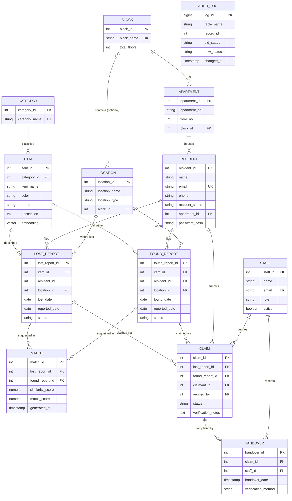

# Lost & Found – Residential Community

A web application where residents of a residential community report lost and
found items, get **semantic match suggestions**, and claim items. Staff verify
claims and record the physical handover. The database enforces the workflow:
only a verified staff member can approve a claim, and a report can only be
closed after a handover is recorded.

PES University · Database Management Systems · Experiential Learning Level 3 (Aug–Dec 2026)

## Technology stack

| Layer | Technology |
|---|---|
| Frontend + API | Next.js (App Router, route handlers), TypeScript |
| Authentication | Auth.js (NextAuth) with credentials login, JWT sessions, bcrypt-hashed passwords |
| Database | PostgreSQL 16 in Docker (`lost-found-postgres`, database `lost_found_db`) |
| Vector search | `pgvector` extension, 384-dimensional embeddings from `all-MiniLM-L6-v2` |
| Embedding job | Python (`sentence-transformers`, `psycopg`) |

## Setup

### 1. Start PostgreSQL (with pgvector)

Use a PostgreSQL 16 image that includes pgvector (for example `pgvector/pgvector:pg16`),
and create database `lost_found_db` with user `lostfound_user`.

### 2. Load the SQL scripts, in this order

| # | Script | Purpose |
|---|---|---|
| 1 | `db/schema_reporting.sql` | Tables for blocks, residents, items, reports, matches; `vector(384)` column |
| 2 | `db/seed_reporting.sql` | Sample data |
| 3 | `db/schema_claims.sql` | Staff, claims, handovers, audit log |
| 4 | `db/claims_security.sql` | Database roles, private schema, signed-assertion functions |
| 5 | `db/triggers.sql` | Status guards, audit trigger, workflow triggers |
| 6 | `db/advanced_claims.sql` | `approve_claim`, `reject_claim`, `record_handover` |
| 7 | `db/pending_claims_view.sql` | `v_pending_claims` view |
| 8 | `db/claims_grants_fix.sql` | Privileges the workflow role needs; removes legacy overloads |
| 9 | `db/advanced_reporting.sql` | Vector and full-text indexes, vector search/update/delete, advanced queries |
| 10 | `db/seed_dev_staff.sql` | Development staff account (local database only) |
| 11 | `db/seed_claims_auth.sql` | Signing key and staff-to-login mapping (needs `-v` variables, see file) |

`db/preflight_claims_migration.sql` is only for upgrading an older database; it is not part of a fresh setup.

PowerShell example (loads every script in order):

```powershell
$files = "schema_reporting","seed_reporting","schema_claims","claims_security",
         "triggers","advanced_claims","pending_claims_view","claims_grants_fix",
         "advanced_reporting","seed_dev_staff"
foreach ($f in $files) {
  Get-Content "db/$f.sql" -Raw |
    docker exec -i lost-found-postgres psql -U lostfound_user -d lost_found_db -v ON_ERROR_STOP=1
}
```

Then provision the claims signing key (generate it, keep it out of git):

```powershell
$key = node -e "console.log(require('crypto').randomBytes(32).toString('hex'))"
Get-Content db/seed_claims_auth.sql -Raw |
  docker exec -i lost-found-postgres psql -U lostfound_user -d lost_found_db -v kid=dev-key-1 -v key_hex=$key
```

### 3. Environment (`.env.local`, never committed)

```
DATABASE_URL=postgresql://lostfound_user:<password>@localhost:55433/lost_found_db
CLAIMS_DATABASE_URL=postgresql://<claims login role>:<password>@localhost:55433/lost_found_db
CLAIMS_KEY_ID=dev-key-1
CLAIMS_HMAC_KEY_HEX=<the same 64 hex characters used in step 2>
AUTH_SECRET=<random string>
```

### 4. Generate embeddings, then run the app

```powershell
python -m venv .venv ; .\.venv\Scripts\activate
pip install sentence-transformers "psycopg[binary]" pgvector
$env:DATABASE_URL = "postgresql://lostfound_user:<password>@localhost:55433/lost_found_db"
python scripts/generate_embeddings.py          # all items
python scripts/generate_embeddings.py --missing-only   # only items edited since

npm install
npm run dev
```

## ER diagram

GitHub renders this Mermaid diagram directly. To get an image for a report, paste it into <https://mermaid.live> and export PNG/SVG.



`audit_log` has no foreign keys: it records status transitions for any table by name.

## Relational schema

PK = primary key, FK = foreign key, UK = unique. Repeating facts (blocks, apartments, categories, locations) live in their own tables so they are stored once and referenced by key.

| Table | Key attributes | Main constraints |
|---|---|---|
| `block` | PK `block_id`; UK `block_name` | `total_floors > 0` |
| `apartment` | PK `apartment_id`; FK `block_id → block` | UK `(block_id, apartment_no)`; `floor_no >= 0`; `ON DELETE RESTRICT` |
| `resident` | PK `resident_id`; UK `email`; FK `apartment_id → apartment` | email format check; phone = 10 digits; `resident_status IN ('active','inactive')`; password stored as bcrypt hash |
| `category` | PK `category_id`; UK `category_name` | – |
| `item` | PK `item_id`; FK `category_id → category` | `embedding vector(384)` |
| `location` | PK `location_id`; FK `block_id → block` (nullable = shared area) | `location_type` from a fixed list; UK `(location_name, block_id)`; `ON DELETE SET NULL` |
| `lost_report` | PK `lost_report_id`; UK+FK `item_id → item`; FK `resident_id`, `location_id` | status ∈ open/matched/claimed/closed; `lost_date <= reported_date`; `ON DELETE CASCADE` from item |
| `found_report` | same shape as `lost_report` | `found_date <= reported_date` |
| `match` | PK `match_id`; FK `lost_report_id`, `found_report_id` (both `ON DELETE CASCADE`) | UK `(lost_report_id, found_report_id)`; `similarity_score` 0–1; `match_score` 0–100 |
| `staff` | PK `staff_id`; UK `email` | `role IN ('staff','admin')`; email/phone checks; `active` flag |
| `claim` | PK `claim_id`; FK `lost_report_id`, `found_report_id`, `claimant_id → resident`, `verified_by → staff` | UK `(lost_report_id, found_report_id)`; decided claims must have a reviewer; rejections must have notes; `ON DELETE RESTRICT` |
| `handover` | PK `handover_id`; UK+FK `claim_id → claim`; FK `staff_id → staff` | one handover per claim; `verification_method` from a fixed list |
| `audit_log` | PK `log_id` | one row per real status change |

A separate `claims_private` schema (not readable by the application roles) holds `account_staff_map`, `assertion_keys`, `consumed_assertions` and `tx_context`, used by the signed-assertion check described below.

## Technology justification

**PostgreSQL + pgvector in a single database.** The core of this system is
relational and transactional: reports, claims and handovers have strict rules
(one claim decision per claim, one handover per claim, status transitions only
in a fixed order). PostgreSQL enforces these with constraints, triggers and
transactions. Semantic matching adds one extra need: finding the found item
whose *description* is closest in meaning to a lost item. Rather than add a
second, separate vector store that would have to be kept in sync with the
relational data, the `pgvector` extension stores the embedding in the `item`
row and lets one SQL query combine vector similarity with ordinary joins and
filters (category, status, location). Embeddings are produced by the
`all-MiniLM-L6-v2` sentence model (384 dimensions) and compared by cosine
distance with an HNSW index. The trade-off is that a dedicated distributed
vector database would scale further, but at community scale one PostgreSQL
instance is simpler, cheaper to run and keeps data consistent.

## The vector feature: create, read, update, delete

| Operation | Where it happens |
|---|---|
| **Create** | `scripts/generate_embeddings.py` stores each item's vector in `item.embedding`; HNSW index `idx_item_embedding_hnsw` in `db/advanced_reporting.sql` |
| **Read** | `find_similar_found_items(lost_report_id, limit)` (SQL function); `GET /api/lost-items/:id/similar`; the match-generation query used by the app; query Q3 in `advanced_reporting.sql`; keyword search `search_items_fulltext()` |
| **Update** | `PATCH /api/lost-items/:id` and `PATCH /api/found-items/:id` edit the item. Trigger `trg_item_text_changed` clears the now-stale embedding and deletes the matches derived from it; `--missing-only` refills it |
| **Delete** | `DELETE /api/lost-items/:id` and `DELETE /api/found-items/:id` call `withdraw_lost_report` / `withdraw_found_report` (removes the report, its matches and its embedding; owner only; blocked once claims exist); procedure `purge_closed_report_vectors()` removes vectors and matches of claimed/closed reports |

`db/dml_demo.sql` demonstrates all four against live data inside a transaction that is rolled back.

## Advanced SQL inventory

| Kind | Objects |
|---|---|
| Functions | `approve_claim`, `reject_claim`, `record_handover`, `find_similar_found_items`, `search_items_fulltext`, `withdraw_lost_report`, `withdraw_found_report`, `item_search_text`, and the assertion functions in `claims_private` |
| Procedures | `claims_private.reserve_assertion`, `purge_closed_report_vectors` |
| Triggers | status guard and audit triggers (`triggers.sql`), claim/handover guards, `trg_item_text_changed` |
| CTEs | recursive CTE (reports per day, Q1), the `candidate_matches` CTE in the matching query |
| Window functions | `RANK() OVER`, running total `SUM() OVER`, percentage of total (Q1, Q2) |
| Other | `LATERAL` correlated subquery (Q3), `NOT EXISTS`, `UNION ALL`, `GROUP BY ... HAVING`, views |

More queries are in `db/queries_reporting.sql` and `db/queries_claims.sql`.

## Authentication and role-based access control

**Application roles:** `resident`, `staff`, `admin`. Passwords are stored as
bcrypt hashes (bcryptjs, cost 12) and the role is carried in the session token; every API route
checks it.

**Database roles:**

| Role | Can do |
|---|---|
| `claims_app` | Read workflow tables; execute `approve_claim`, `reject_claim`, `record_handover`, `reserve_assertion`; no direct writes to claim tables |
| `claims_workflow_owner` | Owns the workflow functions and triggers; has only the specific column-level writes the workflow needs |
| `claims_security_owner` | Owns the private identity schema |

Approving, rejecting and recording a handover each need a short-lived
**signed assertion** (HS256, 60 seconds, single use) created by the server for
the logged-in staff member. The database verifies the signature, scope and
expiry, rejects a replayed token, maps it to an active staff account, and only
then allows the change. Calling the functions directly without such a token
fails.

## Testing

| Script | What it checks |
|---|---|
| `db/test_claim_workflow.sql` | Tables, functions, roles, constraints, triggers and privileges for the claims workflow are installed correctly |
| `db/dml_demo.sql` | INSERT / UPDATE / DELETE and vector create-read-update-delete, plus constraints rejecting bad data (all rolled back) |

## Known limitations

- The main application connection (`DATABASE_URL`) uses the table-owner role, so database-level privilege separation protects the claims workflow but not the reporting tables. A restricted role for the reporting routes is the next step.
- The edit, withdraw and similar-items features are implemented as API routes; buttons for them in the resident interface are not built yet.
- `seed_dev_staff.sql` creates a development admin with a known password. Use it only on a local database and never in a shared deployment.
- Embedding generation loads the sentence model each time a script runs, so the first embedding after starting is slow.
